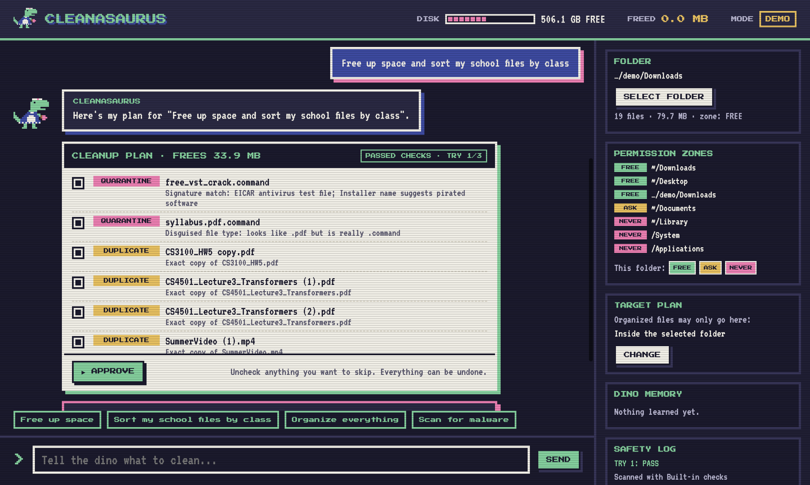

# Cleanasaurus MVP

A local desktop app (Electron) where an 8-bit maid T-rex chatbot cleans, organizes, and malware-checks your files from plain-English requests. Every plan the LLM writes goes through a validator before you see it. Failed plans go back to the LLM automatically (up to 3 tries), and when it's still stuck or sees something strange, it asks you and remembers the answer.

No server or backend service is needed. Everything runs on your computer.



## Run it

```bash
cd app
npm install
npm run demo        # creates a messy fake folder at ~/CleanasaurusDemo/Downloads and opens the app on it
npm start           # opens the app; pick any folder with SELECT FOLDER, or press ▶ DEMO for a guided tour
npm test            # 16 backend tests, incl. 9 minimal-functionality checks (MIN-1 … MIN-9)
npm run test:ui     # opens the real app and clicks through it: plan, approve, undo, NEVER zone, questions
```

**Claude vs. demo mode.** With `ANTHROPIC_API_KEY` set (or a key pasted in the app's side panel), plans come from Claude (`claude-opus-5-5`, structured JSON output). Without a key, the app runs in **DEMO MODE** with an offline rule-based planner, so it still works in class with no internet. The validator, malware checks, zones, and undo are the same in both modes.

**Malware checks.** Uses ClamAV if installed (`brew install clamav`), plus built-in checks: the EICAR test signature, disguised file types (`syllabus.pdf.command`), pirated-software names, and unsigned apps. The demo folder contains two harmless test files that trigger these checks.

**Safety.** Nothing is permanently deleted. Duplicates go to the Dino Bin and flagged files to quarantine, both in the app's data folder, and every run can be undone. `~/Library`, `/System`, `/Applications`, and any git repo are never touched.

## How it's split

| Area | Files | Owner |
|---|---|---|
| UI (chat, dino sprite, plan cards, questions, side panels) | `renderer/index.html`, `renderer/style.css`, `renderer/app.js`, `renderer/sprite.js` | Wesley Chang, Nate Park |
| Electron shell + IPC bridge | `main.js`, `preload.js` | Nate Park |
| Engine (scan → plan → validate → retry → ask) | `backend/engine.js` | Nate Kim |
| LLM planner + offline demo planner | `backend/planner.js` | Nate Kim |
| Validator (the guardrail) | `backend/validator.js` | Nate Kim |
| Scanner, malware checks, executor + undo, profile | `backend/scanner.js`, `backend/malware.js`, `backend/executor.js`, `backend/profile.js` | Nate Kim |
| Demo data + tests | `scripts/make-demo-folder.js`, `test/` | Everyone |

## What the validator checks

1. **Schema:** known operation, absolute paths, a reason for every action.
2. **Permission zones:** NEVER zones are rejected; ASK zones are unchecked until the user ticks them.
3. **Target plan:** new folders and moved files must land inside the user's chosen destination.
4. **Duplicate proof:** a file can only be trashed if its SHA-256 matches a copy that survives the plan.
5. **Malware ground truth:** only scanner-flagged files can be quarantined.
6. **Dry run:** the whole plan runs on a virtual copy of the folder: no overwrites, no missing folders, no lost files.
7. **Strange things:** moving or removing a file over 1 GB becomes a question for the user. The planner is also told to ask, not guess, about look-alike versions.
